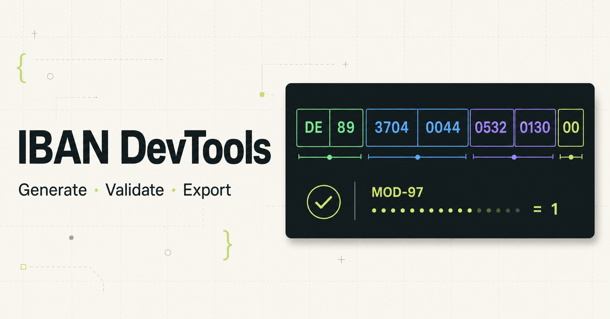

# IBAN DevTools

一款为开发者设计的完整跨国测试身份、IBAN、本地银行标识、KYC 与支付测试数据工作台。网页生成默认完全在浏览器本地完成，也提供可选的 Edge API 与 CLI。

[](https://vercel.com/new/clone?repository-url=https%3A%2F%2Fgithub.com%2Ftianrking%2Fiban-devtools)
[](https://deploy.workers.cloudflare.com/?url=https://github.com/tianrking/iban-devtools)
[](https://github.com/tianrking/iban-devtools/actions)



## 功能

- 提供 250 个可选市场：249 个 ISO 3166-1 国家/地区条目，以及使用用户分配代码 `XK` 的科索沃
- 国家/地区显示名由标准区域名称生成；币种由 SIX 官方 ISO 4217 `2026-01-01` 快照校正，支持海地、巴拿马等多币种市场选择
- 全球地理快照包含 5,308 个州/省级地区与 152,970 条城市记录；223 个市场含城市数据，27 个市场暂无城市记录
- 全球目录按国家拆分并按需加载，只在选择国家后下载对应地理文件，不会把完整城市库打进首屏 JavaScript
- 内置 89 个 SWIFT IBAN Registry 国家/地区结构，覆盖 SEPA 与全球正式注册的 IBAN 格式
- 美国生成带校验位的 ABA routing + account，加拿大生成 9 位电子 routing + account，墨西哥生成带校验位的 18 位 CLABE，阿根廷生成带双校验位的 22 位 CBU
- 非 IBAN 市场使用明确分级的本地支付测试标识；澳大利亚 BSB、印度 IFSC、中国 CNAPS、日本 Zengin、香港清算代码、新西兰、新加坡与南非的路由部分使用独立国家标签，账户长度是项目 fixture，并明确标为 `format-only`
- 使用 ISO 13616 / MOD-97 算法生成合法校验码
- 支持合法、错误校验码、错误长度、非法字符、错误 BBAN、小写和连字符测试用例
- 单条生成、自定义 BBAN、格式化与 Raw 输出，并支持分层错误诊断
- 国家、州/地区、城市三级联动，确保目录中的城市属于所选地区；无城市记录的市场会明确使用合成测试地区
- 国家搜索、SEPA 与全球区域筛选、币种与注册表结构提示
- 支持随机、指定与区间年龄策略，以及性别、姓名、街道和邮编覆盖
- 支持固定随机种子，可稳定复现同一套回归测试数据
- 完整身份包含证件、护照、地址、保险、税务、IBAN 或本地支付标识、BIC、沙盒银行卡、企业、薪资和 KYC 字段
- 支付字段包含 SCT/LOCAL、End-to-End ID、RF Creditor Reference、Purpose Code、VoP 与结构化地址
- 完整身份支持 1–1000 条批量生成，25 条分页预览
- 内置 KYC、支付、薪资、电商、SEPA、API 边界和数据库种子场景
- 整批导出 JSON、NDJSON、完整字段 CSV、TypeScript、Zod、JSON Schema、Playwright、Cypress、Postman、`.env`、SQL 与 Python
- 跟随当前国家的上下文场景预设、配置恢复/重置、可复现 URL、深色模式与 `⌘K` 命令面板
- 界面默认英文，支持 English、Español、Français、العربية、繁體中文与简体中文；阿拉伯语自动启用 RTL，IBAN、卡号和代码仍保持 LTR
- 语言偏好保存在浏览器并写入分享链接；国家显示名随界面语言本地化，JSON、CSV、Schema 等开发者导出字段与固定种子结果保持稳定
- 移动端固定生成操作栏，长表单中无需反复滚动寻找生成按钮
- 支持离线安装的 PWA；浏览器工作台不上传输入，仅在本地保存最后一次配置
- 提供 CORS Edge API、命令行工具与每月 SWIFT 注册表版本提醒
- 同一套源码可部署到 Vercel 和 Cloudflare Workers

## 本地开发

需要 Node.js 22.13 或更高版本。

```bash
git clone git@github.com:tianrking/iban-devtools.git
cd iban-devtools
npm ci
npm run dev
```

访问终端输出的本地地址即可使用。

## 构建与检查

```bash
# Cloudflare / vinext 构建
npm run build:cloudflare

# Vercel / 原生 Next.js 构建
npm run build:vercel

# 运行完整检查
npm run check

# CLI
npm run cli -- generate --country DE --count 10 --seed qa-01 --format json
npm run cli -- generate --country JP --region Tokyo --city Chiyoda-ku --seed jp-qa --format json
npm run cli -- generate --country US --count 10 --seed ach-qa --format json
npm run cli -- generate --country PA --currency USD --count 10 --seed pa-usd --format json
npm run cli -- validate DE89370400440532013000
npm run cli -- countries
```

GitHub Actions 会在每次推送与 Pull Request 时同时验证两个目标平台。

## API

三个 Route Handler 可直接运行在 Vercel Edge 或 Cloudflare Workers：

```bash
# 生成一条或一个批次（最大 1000，默认从所选市场的目录中选择城市）
curl 'http://localhost:3000/api/generate?country=FR&count=10&seed=qa-01&scenario=sepa'
curl 'http://localhost:3000/api/generate?country=US&count=10&seed=ach-qa&scenario=payments'

# 分层校验
curl 'http://localhost:3000/api/validate?iban=DE89370400440532013000'

# 获取国家注册表
curl 'http://localhost:3000/api/countries'
```

`/api/generate` 与 `/api/validate` 同时支持 JSON `POST`，并返回 `Access-Control-Allow-Origin: *`，便于 Postman、Cypress 和 Playwright 直接调用。

## 一键部署

### Vercel

[](https://vercel.com/new/clone?repository-url=https%3A%2F%2Fgithub.com%2Ftianrking%2Fiban-devtools)

也可以导入本仓库。根目录的 `vercel.json` 会选择 Next.js 并执行 `npm run build:vercel`，无需环境变量。

### Cloudflare Workers

[](https://deploy.workers.cloudflare.com/?url=https://github.com/tianrking/iban-devtools)

使用 Wrangler 部署：

```bash
npm run deploy:cloudflare
```

`wrangler.jsonc` 已配置 Worker 入口、静态资源目录和可观测性，无需数据库或其他绑定。

## 项目结构

```text
app/
├── api/             # Edge generate / validate / countries 接口
├── page.tsx         # 身份工作台、场景、批量导出与校验交互
├── globals.css      # 产品视觉与响应式样式
├── pwa-register.tsx # 离线应用注册
└── layout.tsx       # 页面元数据、PWA 与社交分享
lib/
├── iban-core.ts        # 89 国注册表、MOD-97、生成与分层校验
├── country-catalog.ts  # 250 个市场的国家、IBAN 与本地支付目录
├── world-country-data.generated.ts # 全球地理索引生成产物
├── national-banking.ts # ABA、加拿大 routing、CLABE 与本地测试标识
├── exporters.ts        # 12 种完整批量开发者导出格式
├── global-test-data.ts # 完整测试身份、KYC 与支付数据
└── german-test-data.ts # 德国 Steuer-ID 校验算法
bin/
└── iban-devtools.mjs   # Node.js CLI
public/
├── data/world/         # 250 个按国家拆分、浏览器按需加载的全球地理文件
├── manifest.webmanifest
├── sw.js
└── og.png
scripts/
├── build-world-geo-data.mjs
└── check-iban-registry.mjs
worker/
└── index.ts         # Cloudflare Worker 入口
vercel.json          # Vercel 构建配置
wrangler.jsonc       # Cloudflare Workers 配置
```

## 算法说明

IBAN 校验基于 ISO 13616：

1. 将前四位移动到字符串末尾。
2. 把字母转换为数字，`A = 10`，…，`Z = 35`。
3. 使用逐位分段求模，避免依赖 `BigInt`。
4. 合法 IBAN 的 MOD-97 余数为 `1`。

生成结果只保证格式和校验算法合法，不代表真实银行账户。

全球国家、地区与城市目录来自 Countries States Cities Database
`v3.2-export.6`，以 ODbL 1.0 许可再分发。该固定社区快照包含 249 个
ISO 3166-1 条目和 `XK` 用户分配代码，共 250 个可选市场；其中 223 个
市场含城市记录，27 个不含城市记录。它不是各国政府实时行政名录，也
不是全球所有城市的官方穷举，不能保证永久完整或零错误。

目录中的州/省、地区和城市名称来自上述快照；生成的街道、门牌号、
邮政编码、姓名、电话、税号、保险号、证件和雇佣信息仍是合成测试数据。
因此，出现真实城市名不表示整条地址真实存在，也不表示邮编与该城市
存在官方对应关系。详细来源、许可与字段级准确性边界见
[DATA_SOURCES.md](DATA_SOURCES.md)。

支付标识按准确性分层展示：89 个 IBAN 格式与美国 ABA、墨西哥 CLABE、
阿根廷 CBU 共 92 个市场提供校验算法；澳大利亚、加拿大、中国、香港、
印度、日本、新西兰、新加坡和南非共 9 个市场提供带本国路由标签的
`format-only` 测试值，但账户长度仍是银行特定或项目 fixture；其余 149
个市场使用明确标注的通用本地账户测试值。所有结果都不会查询真实银行
或账户目录。

币种映射来自 SIX（ISO 4217 Maintenance Agency）发布的 List One
`2026-01-01` 快照；生成脚本同时校验地理压缩包与币种 XML 的 SHA-256。

德国 Steuer-ID 使用 ISO/IEC 7064 MOD 11,10 校验算法，并采用经典的十位主体数字重复规则。其他国家的税务与保险字段明确标记为格式测试值。沙盒银行卡为公开测试卡，不能用于真实扣款。

如需从固定源重新生成全球地理目录和轻量国家元数据：

```bash
npm run geo:world
```

## 免责声明

本工具生成的跨国身份、IBAN、保险与银行卡字段仅供软件开发、测试和教学使用。格式或校验码通过不代表真实账户、真实个人或官方签发记录。
